# Manuwave Studio

**Make complete songs — music, lyrics and cover art — with AI that runs entirely on your own computer.**
No subscription, no cloud, no upload. Describe an idea (or roll the dice), and Manuwave Studio writes a
production brief, renders the track with ACE-Step 1.5, paints a cover, and lets you master and export it.
Or make the music yourself: synthesizers, a drum machine and a MIDI keyboard, right in the browser — or a loop
machine whose generators play on their own while you turn the knobs, and that hands your jam or your voice to the
music AI to finish the song.

[](LICENSE)

-76b900)

Listen to music made with it on **[Fahrstuhlmusik](https://fahrstuhlmusik.maro-datacenter.de)** — the project's
hobby showcase, where you can also share your own tracks.

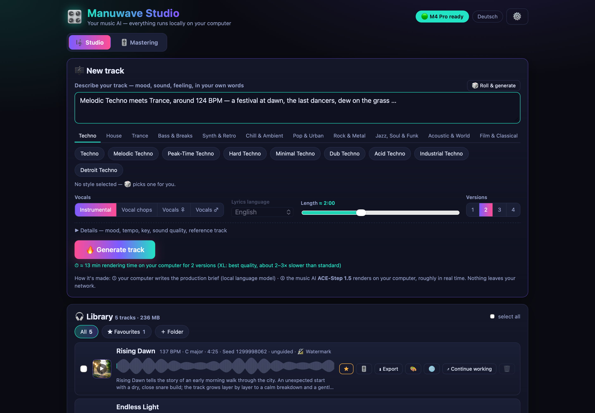

> The interface speaks **English and German** — it follows your browser language, and the button in the top bar switches it. The dice writes its ideas in the language you use.

> What changed in each version: [CHANGELOG.md](CHANGELOG.md).

## What it does

| | |
|---|---|
| 🎼 **Idea → song** | One sentence is enough. A local language model turns it into a brief: sound tags, tempo, key, structure and original lyrics. Already run Ollama yourself? Pick one of your own models under ⚙️ — it is used directly, nothing is downloaded twice. |
| 🧬 **From your songs** | Upload 1–3 songs: your computer measures tempo, key, chords, groove, instrumentation, energy and structure, the AI writes a new song with their character — no melody or lyrics taken over. |
| 🎲 **Dice** | Picks from 114 styles in 11 groups — from melodic techno to bossa nova, metal, film score — and writes a detailed idea, then renders right away. |
| 🎶 **Music AI** | [ACE-Step 1.5](https://huggingface.co/ACE-Step/Ace-Step1.5) via [acestep.cpp](https://github.com/ServeurpersoCom/acestep.cpp) renders instruments, vocals and mix in one pass. |
| 🎨 **Cover art** | FLUX.2 [klein] 4B (macOS) or Z-Image Turbo (Windows/Linux) paints a cover that fits the mood. |
| 🔎 **Quality check** | A listening-judgement model ([Meta Audiobox Aesthetics](https://github.com/facebookresearch/audiobox-aesthetics)) rates every finished take on your computer. Weak takes are rendered again automatically (up to twice, your choice) and the best one is kept; discarded takes stay in `renders/_verworfen` so you can check the verdict. |
| ⏱ **Long tracks** | Up to 10 minutes. Beyond 4 minutes the music AI gets unstable, so the studio renders a main part and then extends it section by section, continuing from the last 30 seconds and crossfading the seam. |
| 🎚 **Mastering** | Quick knobs plus a parametric 8-band equalizer over the track's spectrum, a dynamic EQ against AI harshness, a de-esser and a glue compressor, mono bass, stereo width, fades and auto-loudness for streaming (−14 LUFS), −16 LUFS or club (−9 LUFS). Save your own presets, keep favourites, let “My sound” learn from your tracks, and give every new track your sound automatically — what you hear is what you export. |
| ⬇️ **Export** | MP3, FLAC, ALAC, WAV, AIFF, WavPack, TTA — with cover, tags and lyrics embedded. |
| 📦 **Release package** | One ZIP with the mastered file, a 3000 × 3000 cover, upload metadata with AI-disclosure checkboxes, lyrics, a proof-of-origin PDF and a licence template (these two documents are in German for now). |
| 🎹 **Make your own** | A third tab with nine basic synthesizers, 18 recreations of classic instruments (TB-303, Minimoog, Juno-60, DX7, Rhodes, B3 …) and a drum machine — every knob included — plus a piano roll, patterns, a song arranger and a loop recorder. Play it with a USB/MIDI keyboard or the computer keyboard. *Create track* renders your piece into the library, where it is mastered, exported and published like any other track. |
| 🔁 **Loop machine** | A fourth tab of generators that run on their own — beat, bass, chords, arpeggio, melody, a free oscillator, your own bars and a mic loop. Start one and it comes in on the next bar; turn frequency, resonance, highs, echo, reverb and more while it plays. *Take over the rest* builds a band around your bars or your voice; the autopilot arranges. |
| 🤖 **AI takes over** | From the loop machine: the music AI continues your jam (your bars are the start of the song) or plays a band around a loop you sang — with your real voice kept on top. The result is an AI track; its note says which part is yours. |
| 🎼 **MIDI image** | Every AI song is turned into notes on your computer — drums, bass, chords and melody, on the beat. Open it on the instruments with one click (*Play*) and change anything, or download it as a MIDI file for any DAW. Optional; runs only while your computer is otherwise idle. |
| 🔏 **Honest by design** | Every file is labelled in its tags — “AI-generated”, or “self-played” for what you made in *Make your own* (then only the cover counts as AI); an inaudible watermark (macOS/Linux) proves where it came from. |

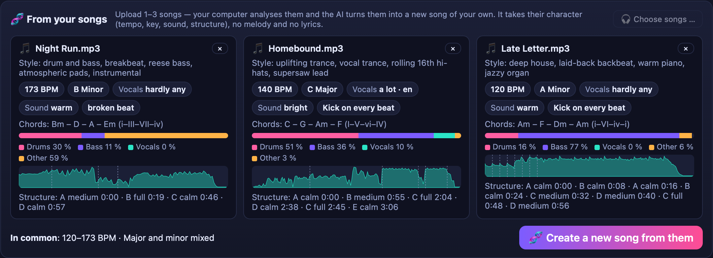

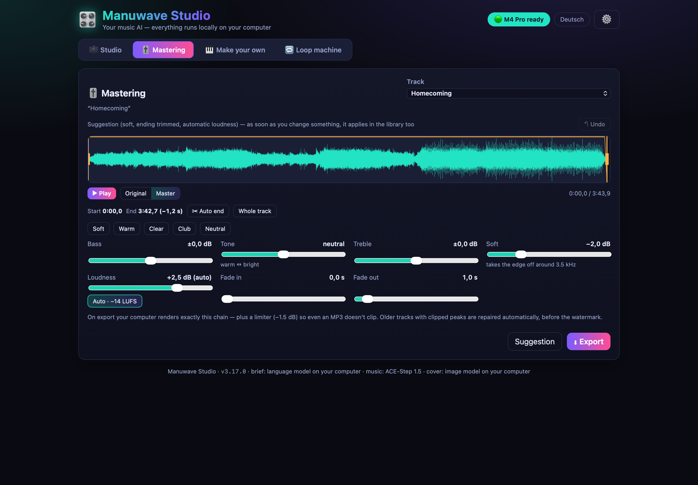

## Make your own

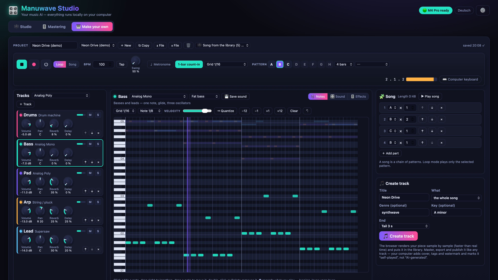

| | |
|---|---|
| 🎛 **Synthesizers** | Analog poly and mono (three oscillators plus sub, ladder filter with a high-pass in front, two envelopes, two LFOs, unison, glide), supersaw, wavetable (six sets: analog, pulse width, sync, wavefolder, vowels, glass), string machine, 4-operator FM with eight algorithms, electric piano, tonewheel organ with nine drawbars, percussion and rotary speaker, and a plucked string (Karplus-Strong). Arpeggiator on every synth. |
| 🏛 **Classics** | 18 recreations, each with its own factory sounds (110 in all): TB-303 (accent; slide when notes overlap, like the original), Minimoog, Juno-60 (with its chorus), Jupiter-8, Prophet-5, OB-Xa, SH-101, MS-20, ARP Odyssey, CS-80, Taurus bass pedals, PPG Wave, DX7, M1 house organ, Rhodes, Wurlitzer, B3 and Clavinet. Save your own sounds. |
| 🥁 **Drum machine** | 16 pads, all synthesized (no samples) — TR-808, TR-909, TR-606, CR-78, 80s, trap, techno and lo-fi kits, each pad with level, pan, tune, decay, tone and snap. Step grid with accents. |
| 🎛 **Knobs** | Click anywhere on a knob's arc and the value jumps there — nothing follows the mouse afterwards. For fine moves hold Shift and drag vertically, or use the mouse wheel; Alt-click restores the default. Knobs grow under the mouse. |
| 🖥 **Full width** | The tab uses the whole monitor: from 1800 px tracks, editor and song sit side by side, and the on-screen keyboard shows as many octaves as fit — five (61 keys, like a common 61-key keyboard) on a wide screen. |
| 🎼 **Patterns & song** | Eight patterns (1–16 bars) per project, piano roll and step grid, swing, quantize, undo. Chain patterns into a song. Up to 16 tracks with volume, pan, EQ, chorus and sends to a shared reverb and tempo-synced delay. |
| 🎹 **MIDI** | Any class-compliant USB/MIDI keyboard: velocity, pitch bend, mod wheel, sustain pedal, volume fader, transport buttons in DAW mode, and *MIDI learn* for every knob. Web MIDI needs Chrome or Edge; without it (Safari) the computer keyboard plays (A W S E D … = C … C, Z/X octave). |
| 🎼 **AI songs on the instruments** | *Play* in the library (or *Song from the library* here) opens a song's MIDI image as a project: drums on the matching kit, Minimoog bass, Prophet chords, Minimoog melody, in parts of 16 bars, at the song's **measured** tempo (the music AI rarely hits the requested BPM exactly). |
| ⏺ **Recording** | One-bar count-in, metronome, quantize to 1/4…1/32, overdub in a loop — every take can be undone. |
| 🎵 **Create track** | Renders the arrangement faster than real time into a 24-bit/48 kHz WAV with a −1.5 dBFS limiter and puts it in the library. Projects are saved in the browser; back them up as a file. |

The classics are our own recreations — no samples, no code from the originals. Their names only say which
instrument inspired them; all trademarks belong to their owners, and there is no affiliation.

The sound runs in one AudioWorklet (band-limited oscillators, zero-delay-feedback filters), so timing stays tight even
when the tab is in the background, and the offline render is sample-identical to what you hear.

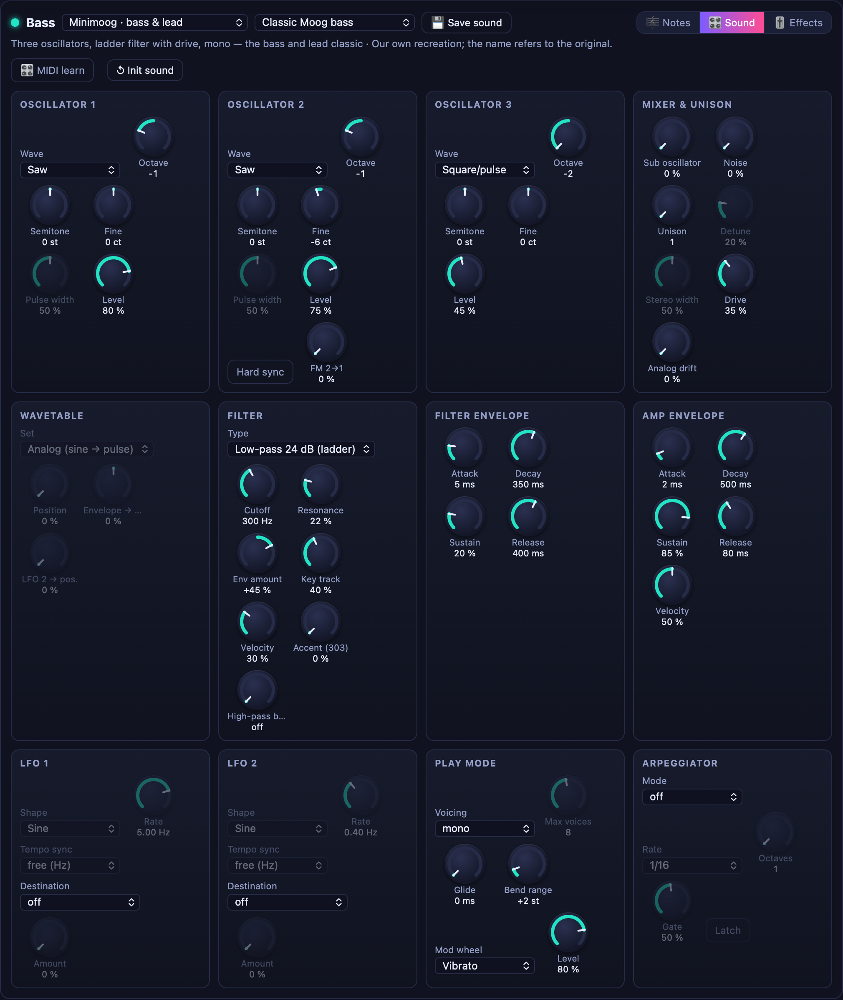

*Play* on an AI song in the library: its MIDI image opens on the instruments — drums, bass, chords and melody at the measured tempo.

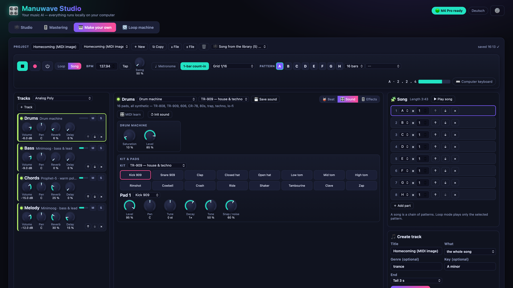

## Loop machine

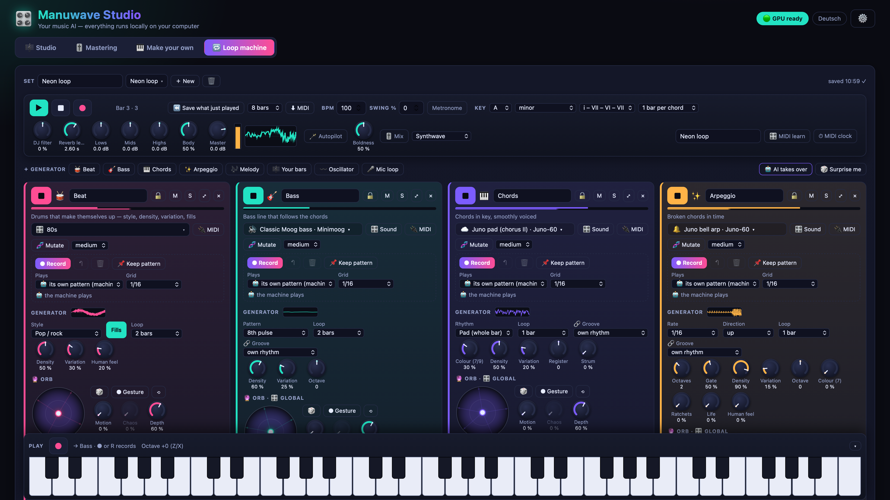

| | |
|---|---|
| ▶︎ **Generators** | Up to twelve, each with its own loop length (1–8 bars). Press ▶︎ and it comes in on the next bar, ■ and it stops at the end of the bar (double-click: right now); space starts or stops all. 🥁 **Beat** — eleven styles, density, variation, human feel, fills. 🎸 **Bass** — eight-note pulse, long roots, house offbeat, disco octaves, acid (303), funk, walking. 🎹 **Chords** — pad, halves, stabs, offbeat, eighths, with 7ths and 9ths, smoothly voiced. ✨ **Arpeggio** and 🎶 **Melody** (a motif that returns and develops). Every generator plays any sound of *Make your own*. |
| 〰️ **Oscillator** | A free tone generator: sine, triangle, saw, pulse, supersaw, white/pink/brown noise; frequency 20 Hz–8 kHz (free, or snapping to the key), fine tune, unison, sub, FM, drift, glide, an LFO on pitch/volume/pulse width/pan/FM, and a gate in time for pulsing tones. |
| 🎼 **Your bars** | Play a few bars after a one-bar count-in (computer keyboard, MIDI or the keys on screen). The machine plays them and spins them on — *life of its own* sets how far it strays; every fourth pass returns to your original. |
| 🎤 **Mic loop** | Sing or play into the microphone, in time, with latency compensation; overdub up to eight layers, undo, stutter, reverse. *To notes* hears out your melody and gives it to a synth that carries it on. |
| 🎛 **Live sound** | On every generator: filter frequency, resonance, high-pass, a tempo-synced wobble, lows/mids/highs, drive, ping-pong echo in time, feedback, reverb, pan, volume, mute/solo. ⤢ (or *Sound*) opens **all settings of a generator** large, across the whole width — generator, orb & global, live sound, recording, MIDI out and every knob of the instrument, side by side over the other generators; the keyboard stays free and plays that generator (Esc closes). Master: DJ filter, reverb length, level, limiter at −1.5 dBFS. *MIDI learn* puts any knob on a controller knob. |
| 👁 **See what you hear** | When the machine changes something — the wobble sweeping the filter, the autopilot closing the filter for a breakdown, the oscillator snapping to the key, gliding, drifting, its LFO or gate — the knob turns with it, and the number shows the value that is sounding right now; your own setting stays as a small dot on the ring. Knobs that have no effect at the moment (oscillator 2 at level 0, pulse width on a saw wave, LFO without a destination …) are dimmed and say why; turning one switches the missing part on. |
| 📈 **Oscilloscopes** | Every group of knobs has a small oscilloscope of the signal at exactly that point: the generator itself, after the filter, after the tone controls, the echo and reverb send, the channel (left and right after the fader, so pan and volume show), the instrument sound, the master after the limiter, the microphone, and the oscillator's LFO. |
| 🎚 **Auto mix** | Listens for two bars, measures how loud each generator really is (before the fader, weighted like the ear) and sets its volume to a target for its role — beat and bass carry, chords and arpeggios sit below, a voice on top — adjusted per style. Runs by itself for *Surprise me*, *Take over the rest* and when the autopilot brings a generator in; volumes you set by hand stay. *Mix* sets all of them. |
| ⌨️ **Keys** | The on-screen keyboard always sits at the bottom of the screen, full width, two to five octaves depending on the width (61 keys at 1920 px); it folds away. |
| 🔮 **Orb** | Drag the dot and three to six knobs move at once — direction picks which, distance how much. It can circle by itself in time (*Motion*, *Chaos*), keeps rolling when you let go, and loops a recorded *gesture*. Your settings stay; the knobs turn visibly. |
| 🎛 **Global** | *Tone, Ambience, Filter, Envelope, Vibrato, Unison* on every sound generator — they know which controls of the current instrument to turn, so they work with every sound. |
| 🧬 **Mutate** | A related variation of the sound, from subtle to extreme, always audible; every mutation is kept and ⟲ brings back the original. Also for the drum kit and the oscillator. |
| 🌀 **Motion & more** | Frequency shifter (also opposed left/right), vibrato and ensemble on every generator; four crossfading **zones** on the oscillator; **granular** mic loop with freeze; arpeggio **ratchets, life, human feel**; **strummed** chords; **analog drift**. |
| 🔌 **MIDI out** | Each generator can play an external device — music software via the Mac's IAC driver, or a hardware synth — on its own channel, timed ahead; the beat as GM drums; optional MIDI clock. Chrome or Edge. |
| 🔗 **Fits in** | A generator you add takes the set's style, the others' loop length and an octave of its own, and can lock its rhythm to the kick, the bass, the chords or answer the melody (*Groove*). While the machine runs it comes in on the next bar, mixed in. |
| ✋ **Record into any generator** | Beat, bass, chords, arpeggio, melody and the oscillator can play exactly what you played instead of their own pattern: press ● (or **R**), play on the on-screen keys, the computer keyboard or a MIDI keyboard, and each pass is snapped to the grid (1/4–1/32, triplets or free), timed as you heard it and looped from the next pass on — keep playing to add more (overdub), ● again to finish. ↶ takes back a pass, 🗑 clears, 📌 keeps the machine's pattern as yours. Drums sit on the keys as on a pad controller (C kick, D snare, F♯ hats …, labelled). With nothing playing there is a one-bar count-in. |
| ⬜ **Empty set** | *+ New* starts empty; a generator added there waits for your playing. *Surprise me* keeps what you played, takes your tempo, reads key and chords from your notes and builds the rest around it. |
| 🎚 **Master tone** | Lows, mids and highs (±12 dB) on the master — in the loop machine and in *Make your own*, recordings and generated tracks included. |
| 🎻 **New instruments** | Computed like the synths, no samples: piano & grand (felt soft pianos with long reverb, echo and shimmer, upright, honky-tonk, celesta), mallets & bells (marimba, vibraphone, glockenspiel, music box, kalimba, tubular and church bells, steel drum, singing bowl, gong), choir & voices (a/e/i/o/u/hum, up to eight singers per note, whisper, overtone singing, robot), orchestra (string sections and solos, pizzicato, tremolo, brass, woodwinds) and wild effects (risers, impacts, lasers, wind, rain, sea, thunder, aliens, glitch, drones). 232 sounds. |
| 🌌 **Space per instrument** | Every instrument has its own reverb (up to 30 s, shimmer, freeze), echo in time or in ms, and body & width. |
| 🎛 **Sound browser** | 17 categories, search, tags, ★ favourites, recent sounds and ▶︎ listen; a click selects right away, the arrow keys browse. |
| 🗂 **Grouped pickers** | Instruments, kits, pad sounds, orchestra and piano types open as an overview — groups, tiles in columns, a description per instrument, search. On a phone: a sheet from the bottom. |
| 🔊 **Fuller sound** | The shared reverb is level-matched (it used to be louder than the instruments), the reverb return starts at 180 Hz, the bass stays mono, and a *Body* control on the master adds gentle saturation, warmth and glue. |
| 🔒 **Lock · ⏪ Flow capture** | Lock a generator so *Surprise me* and the autopilot leave it alone. The machine always listens: *Save what just played* puts the last 4/8/16 bars into the library after the fact, *⬇ MIDI* gives the same bars as a MIDI file. |
| 🎹 **Harmony** | Key (ten scales incl. pentatonic and blues), chord progression and bars per chord apply to all generators; a change takes effect on the next bar. |
| 🪄 **Take over the rest** | From your bars or your voice the machine finds the key, then adds beat, bass and chords (plus an arpeggio for some styles) in the style you choose and switches on the **autopilot**, which arranges every eight bars: swaps generators (the one leaving fades out over two bars, the one coming in fades in), builds a breakdown with a closing filter, a build-up to the drop, fresh patterns. 🎲 *Surprise me* starts a random style. |
| 🤖 **AI takes over** | *Continue the jam*: the next 4, 8 or 16 bars are captured exactly from the downbeat and the music AI continues from there (ACE-Step repaint) to the song length you pick — matched in loudness. *Band for your voice*: your mic loop is repeated to song length and ACE-Step's *complete* task plays drums, bass, keys and more around it; Demucs then removes the AI's own re-sung voice and puts **your** voice back on top. Runs on your computer like any render; needs the base model for the full band (installer step *Loop machine AI*). |
| ⏺ **Record** | ● records what you hear (after the limiter) into the library as a 24-bit WAV — self-played, no music AI involved. Sets and loops are saved in the browser. |

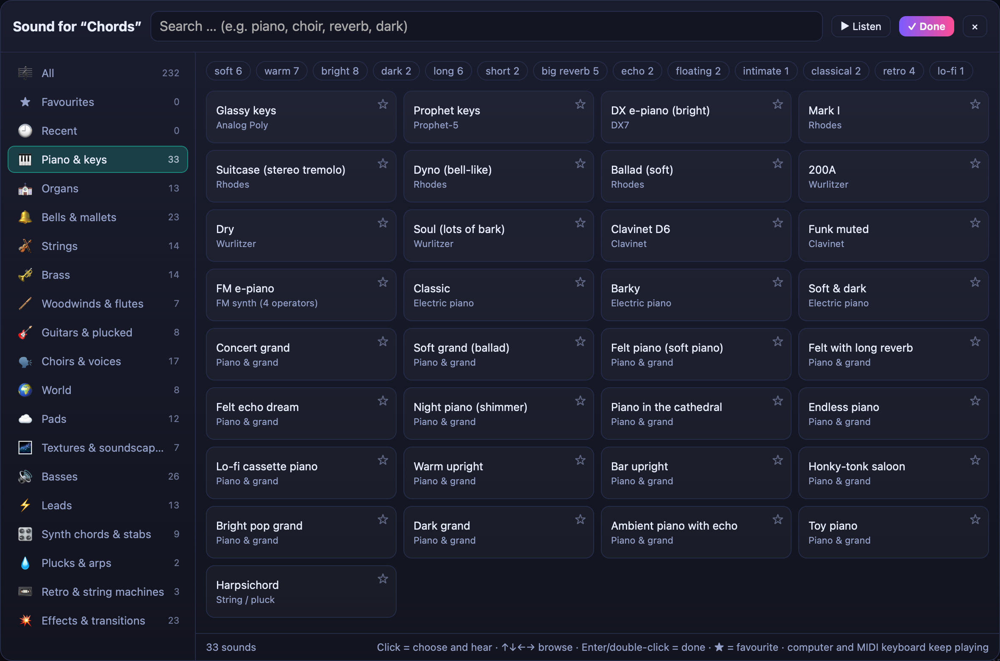

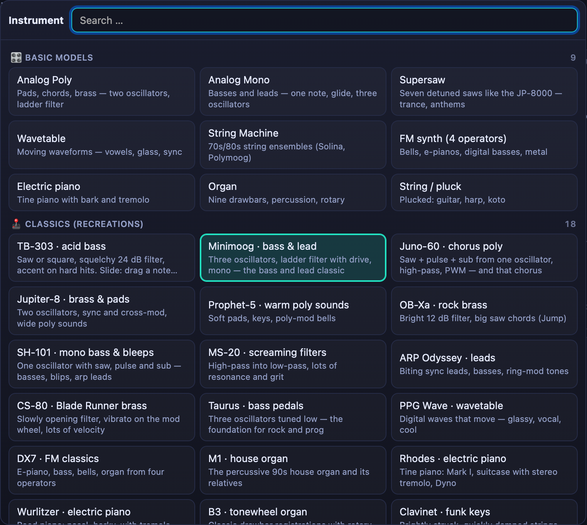

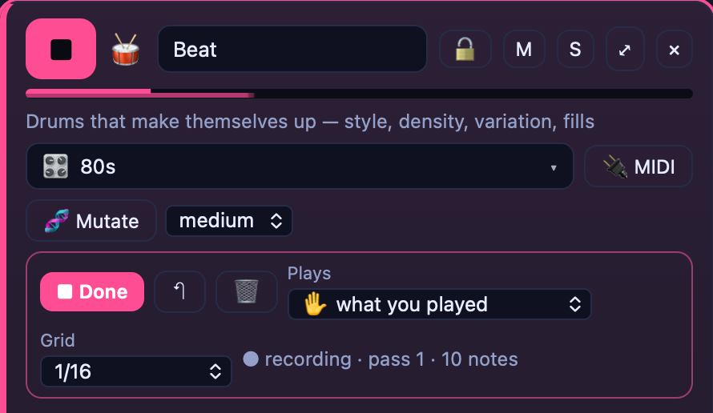

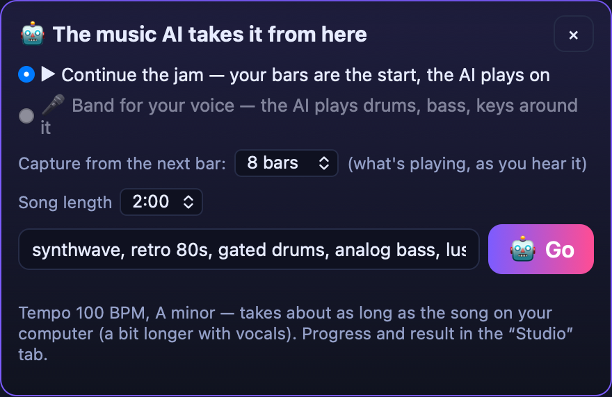

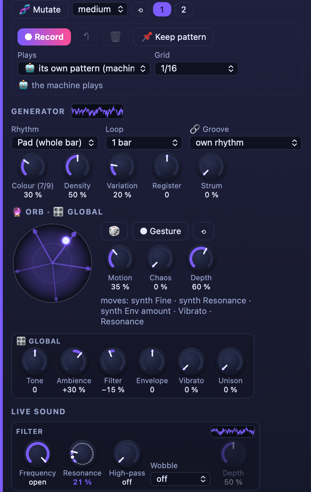

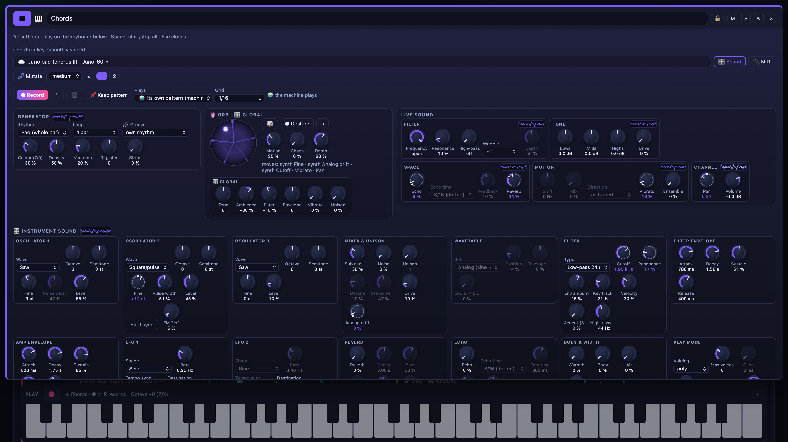

## Requirements

| | macOS | Windows / Linux |
|---|---|---|
| Hardware | Apple silicon, M1 or newer, 16 GB RAM recommended (8 GB works with smaller models) | NVIDIA GPU, RTX 20xx or newer, 8 GB VRAM; driver ≥ 550 |
| System | macOS 14 or newer | Windows 10/11 · Ubuntu/Debian x86_64 |
| Disk | about 25 GB (+1 GB for the optional quality check, +1.5 GB for the optional MIDI image, +2.6 GB — 5.3 GB with `--xl` — for the optional loop machine AI) | about 25 GB (+1 GB quality check, +1.5 GB MIDI image, +2.6/5.3 GB loop machine AI, all optional) |
| Status | ✅ tested | ⚠️ experimental — built and checked in CI, not yet run on real NVIDIA hardware by the maintainer |

## Install

1. Download the latest release ZIP (or `git clone` this repository) and unpack it.
2. Run the installer for your system:
   - **macOS:** double-click `install/macos/Install Manuwave Studio.command`
     (Homebrew is installed if missing — macOS asks for your password once).
   - **Windows:** double-click `install\windows\Install Manuwave Studio.bat`.
   - **Linux:** `./install/linux/install.sh`
3. The installer downloads everything from the original sources (about 15–20 GB of models), builds what needs
   building, and creates a **Manuwave Studio** launcher (Desktop on macOS/Windows, app menu on Linux).
   Interrupted? Just run it again — downloads resume and finished steps are skipped.

Everything lives in `~/ManuwaveStudio` (`%USERPROFILE%\ManuwaveStudio` on Windows). Your music is stored there
under `renders/` and in your browser's library.

<details><summary>Installer options</summary>

| Option | Effect |
|---|---|
| `--lm 0.6B \| 1.7B \| 4B` | size of the music AI's planning model (default: chosen by RAM) |
| `--xl` | the larger, better-sounding XL model (+3 GB) |
| `--skip-writer`, `--skip-image` | skip the language model or the cover model |
| `--skip-qa` | skip the quality check (PyTorch + rating model, about 1 GB; runs on the CPU) |
| `--skip-midi` | skip the MIDI image (Demucs + Basic Pitch, about 1.5 GB) |
| `--skip-loopai` | skip the loop machine AI (the base model for *band for your voice*, 2.6 GB or 5.3 GB with `--xl`); continuing a jam still works |
| `--no-start` | don't start the app at the end |
| `--home DIR` | install somewhere else (must be inside your home folder) |

Windows: `-Lm`, `-Xl`, `-SkipWriter`, `-SkipImage`, `-SkipQa`, `-SkipMidi`, `-SkipLoopAi`, `-NoStart`.
</details>

## Update

From 3.23 on, Manuwave Studio updates itself with one click:

- When a new release is out, **⬆ Update x.y.z** appears at the top right. It opens the release notes and an
  **Update now** button.
- One click downloads the release from GitHub, checks it (it must compile and start on a spare port first),
  keeps the previous version in `app.prev` and restarts — the page reloads by itself. Your music, library, settings
  and pairing stay as they are. While a job is running, the update waits.
- The app asks GitHub for the latest release at most every six hours. You can switch that off under ⚙️ → *Updates*,
  and check by hand there.
- If a release needs new components (models, tools), the notice says so and you run the installer again instead:
  close the Manuwave Studio window first, then download the new release ZIP and run the installer with the same options.
  Finished steps are skipped, so models are not downloaded again.

**Versions before 3.23** don't have the updater yet. Update them once with the installer as described above.

**Git clones made before 2026-10-21:** the repository history was rewritten on that day, so `git pull` refuses to
merge. Clone the repository again (or `git fetch origin && git reset --hard origin/main` if you changed nothing).

## If something doesn't work

- **Keep the start window open.** *Manuwave Studio* (the window that opens when you start it) runs the app and the
  bridge, and starts either of them again if it stops. Closing it stops everything.
- **🔴 App not responding** at the top right means the app is not running: open the start window again. The page
  carries on by itself once it's back.
- **Logs** are in `~/ManuwaveStudio` (`%USERPROFILE%\ManuwaveStudio` on Windows): `app.log`, `bridge.log`, and
  `app.restart.log` / `bridge.restart.log` after a restart. They help when you report a problem.
- **Windows installs before 3.24.1** could not run in Windows PowerShell 5.1. Download 3.24.1 and run the installer
  again — finished steps are skipped.

## How it works

```
Browser (UI, library)  ⇄  app server (127.0.0.1:8104)  ⇄  bridge  ─┬─ ace-server  (ACE-Step 1.5, GPU)
                                                                  ├─ Ollama      (Qwen 2.5 or your own model — brief & lyrics)
                                                                  ├─ cover model (FLUX.2 klein / Z-Image Turbo)
                                                                  ├─ quality check (Audiobox Aesthetics, CPU, optional)
                                                                  ├─ MIDI image    (Demucs + Basic Pitch, when idle, optional)
                                                                  └─ ffmpeg · audiowmark (mastering, tags, watermark)
```

The app server only brokers jobs; the **bridge** does the work and starts each model only while it's needed.
Nothing listens on your network — everything binds to `127.0.0.1`.

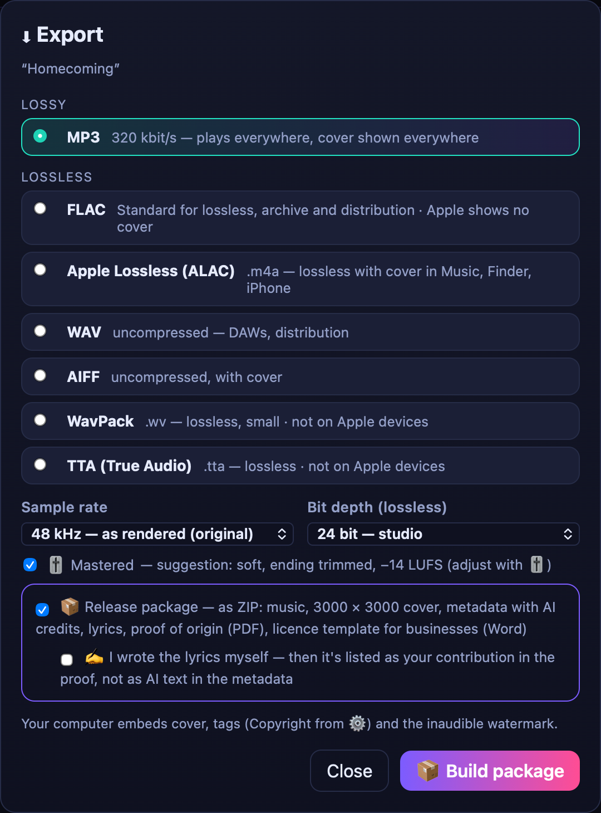

## Using your music

- **Licences:** ACE-Step 1.5 (MIT; its model card explicitly allows commercial use of generated music),
  FLUX.2 [klein] 4B and Z-Image Turbo (Apache-2.0). See [THIRD_PARTY.md](THIRD_PARTY.md).
- **Copyright:** in many countries purely AI-generated content is not protected by copyright. Your own
  contributions — lyrics you write, your selection and mastering — can be. The release package records them.
- **Distribution:** many distribution services accept AI-assisted music if you disclose it; the release package
  contains ready-to-tick AI credits. Some platforms and music libraries don't accept AI-generated music — check
  their rules first.
- **Self-played tracks** (*Make your own*, or recorded in the loop machine) are your own work: the tags, the release
  package and Fahrstuhlmusik say “self-played”, and only the cover is declared as AI.
- **AI takes over** results are AI tracks — the note records which part is yours (your bars or your voice).
- This is not legal advice.

## Uninstall

Quit the launcher, then delete `~/ManuwaveStudio` (and on macOS, optionally, the Homebrew packages listed in
`install/macos/install.sh`). Nothing else is installed.

## Licence

**Source-available, not open source** — see [LICENSE](LICENSE). You may run it for yourself; you may not
redistribute or modify it without permission. Music you make is yours.
